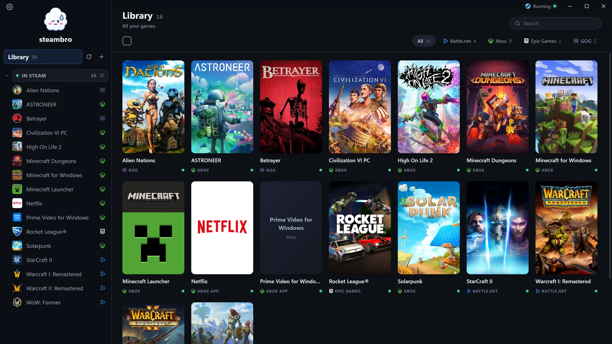
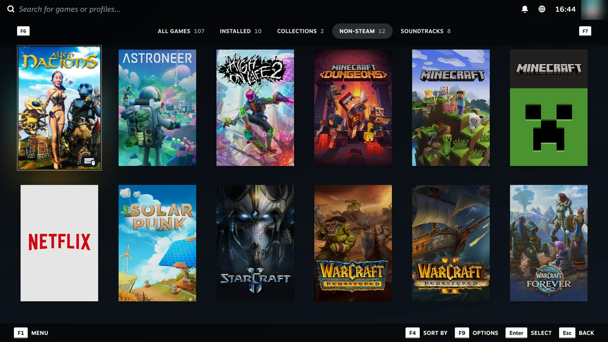
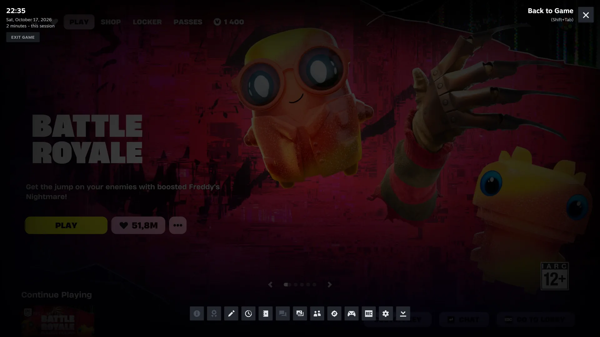
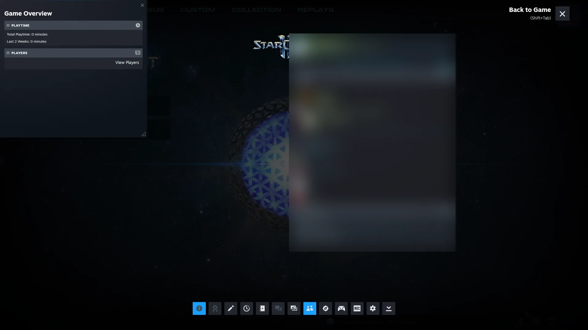
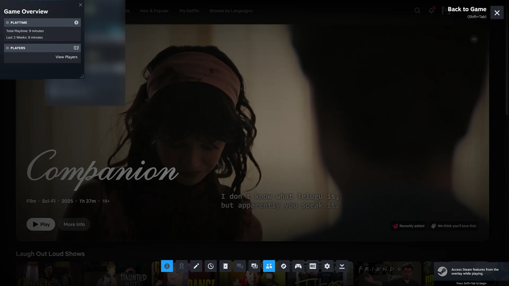
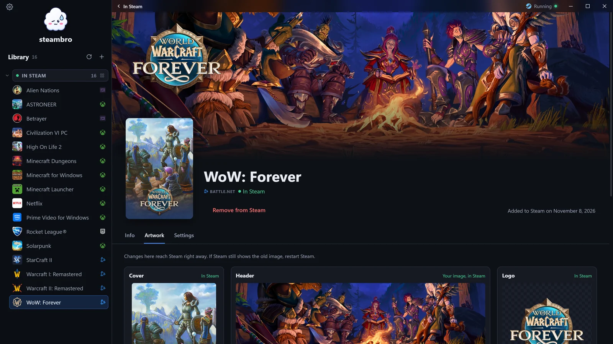
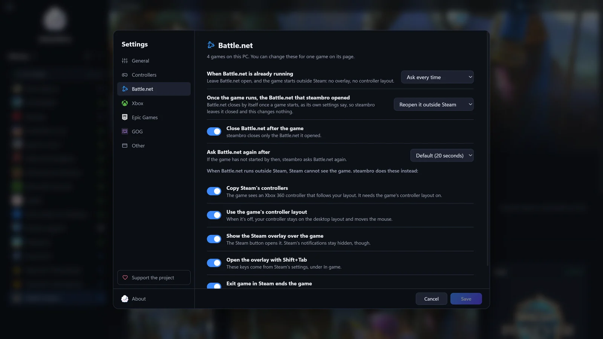
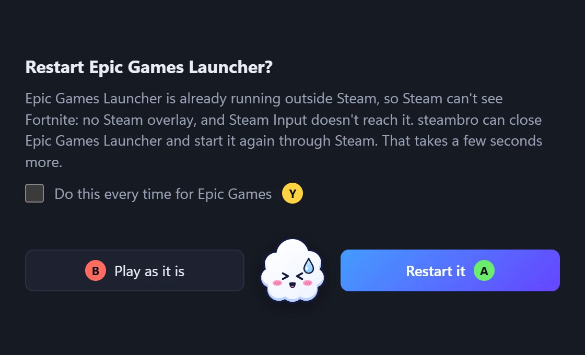
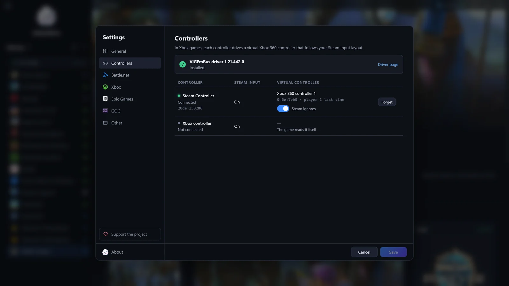
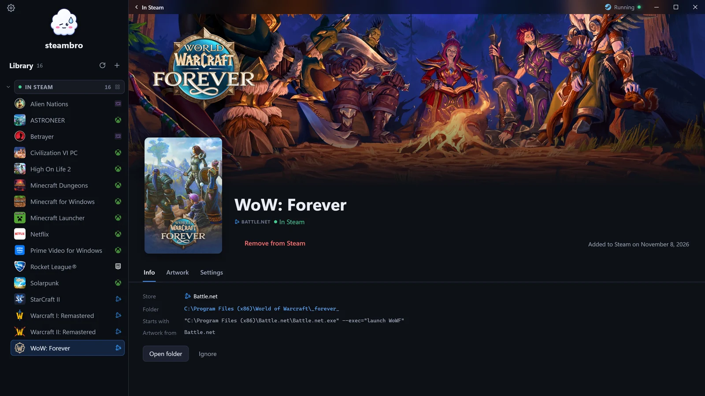

<p align="center"><a href="README.md">English</a> · <a href="README.ru.md">Русский</a> · <a href="README.es.md">Español</a> · <a href="README.pt-BR.md">Português (Brasil)</a></p>

<p align="center"></p>

<h1 align="center">steambro</h1>

<p align="center">steambro añade tus juegos de Game Pass, Epic, Battle.net y GOG a Steam, para que tu configuración del mando de Steam Input y la superposición de Steam funcionen en ellos.<br>
Windows 10 y 11. No es para Steam Deck, Linux ni macOS. Software libre bajo la <a href="LICENSE">GPL-3.0</a>.</p>

<p align="center">
  <a href="https://github.com/shalamowww/steambro/releases/latest"><b>Descargar para Windows</b></a> ·
  <a href="https://steambro.app/es/">steambro.app</a> ·
  <a href="#cómo-funciona">Cómo funciona</a>
</p>



Pulsa Jugar en Steam, en el escritorio o en Big Picture, y el juego se inicia como lo inicia su tienda. Steam lo muestra en ejecución y cuenta el tiempo de juego. Cualquier mando compatible con Steam Input funciona en los juegos de Epic, Battle.net y GOG. El ratón y el teclado también funcionan. steambro no es oficial y no tiene relación con Valve, Microsoft, Blizzard, Epic Games ni GOG.

## Instalación

1. Consíguelo en [Microsoft Store](https://apps.microsoft.com/detail/9NQVZ9CVTG85), o descarga el instalador (`-setup.exe`) o el zip portable desde [Releases](https://github.com/shalamowww/steambro/releases/latest). No hacen falta permisos de administrador.
2. Ejecútalo. Si Windows SmartScreen avisa con la versión de GitHub, selecciona «Más información» y luego «Ejecutar de todas formas».
3. Selecciona tus juegos y luego «Añadir a Steam». Steam se reinicia una vez.
4. Si usas un mando que no es de Xbox en los juegos de la app de Xbox, instala el [controlador ViGEmBus](https://steambro.app/es/driver) gratuito. Los ajustes te dicen cuándo.

## Tiendas y mandos

steambro encuentra los juegos que tienes instalados. Lee los registros de cada tienda y nunca escanea tu disco.

- [App de Xbox y Game Pass](https://steambro.app/es/game-pass): tu configuración del mando de Steam Input y la superposición de Steam funcionan en los juegos de la app de Xbox.
- [Epic Games](https://steambro.app/es/epic-games): el Epic Games Launcher se abre dentro de Steam, así que Steam ve el juego y la superposición funciona.
- [Battle.net](https://steambro.app/es/battle-net): steambro encuentra todos los juegos de Blizzard instalados, betas y reinos de prueba incluidos, e inicia Battle.net dentro de Steam.
- [GOG](https://steambro.app/es/gog): steambro inicia el juego por su cuenta, con las imágenes de GOG, así que GOG Galaxy puede quedarse cerrado.
- [Apps de la app de Xbox](https://steambro.app/es/netflix): Netflix y Apple TV se abren desde Steam a pantalla completa.
- Cualquier exe: selecciona + y luego el exe, y el juego toma su icono y un nombre de su carpeta.

Los mandos de Xbox no necesitan configuración. En los juegos de la app de Xbox, un [Steam Controller](https://steambro.app/es/steam-controller), [DualSense](https://steambro.app/es/ps5-controller), DualShock 4 o Switch Pro necesita el [controlador gratuito ViGEmBus](https://steambro.app/es/driver), y el juego muestra los botones de Xbox. De estos, por ahora solo el Steam Controller está probado ahí. Los juegos de Epic, Battle.net y GOG no necesitan nada más.

## Qué consigues

- **Un botón Jugar con imágenes reales:** cada juego tiene su propio acceso directo en Steam, con las imágenes de la tienda recortadas a los tamaños de Steam. [Ajusta cualquier recorte o usa tu propia imagen](https://steambro.app/es/artwork).
- **Tu configuración del mando de Steam Input en el juego:** en los juegos de Epic, Battle.net y GOG, los trackpads, el giroscopio y los menús radiales siguen la configuración que pusiste en Steam.
- **La superposición de Steam y el tiempo de juego:** Mayús+Tab o el botón Steam abre la superposición sobre el juego. Steam muestra el juego en ejecución y cuenta el tiempo de juego.
- **Juega desde el sofá:** tus juegos de todas las tiendas están en Big Picture con sus imágenes: elige uno en la tele y pulsa Jugar. La ventana de steambro también se maneja con mando.
- **Los accesos directos que hiciste se quedan como están:** un acceso directo creado por ti o por UWPHook aparece en «Añadidos por otra vía», y steambro no lo toca. [Compara steambro con UWPHook, GlosSI y SISR](https://steambro.app/es/compare).

**[WoW: Forever con un Steam Controller](https://steambro.app/es/wow-forever).** WoW: Forever trae su propia compatibilidad con mando. steambro añade Steam Input encima: trackpads, giroscopio, botones traseros y la superposición de Steam, con las imágenes de Battle.net. Añade el juego, activa Gamepad en sus opciones y pulsa Jugar en Steam.



| La superposición de Steam sobre Fortnite, de Epic Games | La superposición de Steam sobre StarCraft II, de Battle.net |
| --- | --- |
|  |  |

| La superposición de Steam sobre Netflix, a pantalla completa | Las imágenes de WoW: Forever en steambro |
| --- | --- |
|  |  |

| Los ajustes de Battle.net: todo lo automático es un ajuste | La pregunta cuando el Epic Games Launcher ya está abierto |
| --- | --- |
|  |  |

| Ajustes, Mandos: qué mando maneja cuál | La página de WoW: Forever, con las imágenes propias de Battle.net |
| --- | --- |
|  |  |

## Cómo funciona

Steam da Steam Input, la superposición de Steam y el tiempo de juego solo a los juegos que inicia él. Por eso cada acceso directo inicia steambro, que inicia el juego como lo hace su tienda.

## Aún no funciona

- Juegos de la EA app y Ubisoft Connect: steambro no los encuentra.
- En los juegos de Game Pass: las notificaciones, la tecla de captura de pantalla y el contador de FPS de Steam.

## No se puede

- Logros de Steam: Steam no tiene logros para un acceso directo.
- Jugar con Steam cerrado: tu configuración del mando y la superposición de Steam vienen de Steam.

## Estado e informes de errores

**Primera versión**, 1.0.0.0. Lo siguiente: más tiendas y más funciones de la configuración del mando de Steam.

Cuando algo salga mal, selecciona «Guardar un informe de error» en el menú de la bandeja o en Ajustes, Acerca de, y adjunta el archivo a un [issue](https://github.com/shalamowww/steambro/issues). El informe tiene los ajustes de steambro y lo que hacen con cada juego, los ajustes de Steam y de las tiendas que importan, y el final de los logs. Tu nombre de usuario de Windows, el nombre del PC y los ID de tus cuentas de Steam se sustituyen. Léelo antes de adjuntarlo.

steambro no tiene telemetría, ni analíticas, ni cuentas. La [página de privacidad](https://steambro.app/es/privacy) dice qué lee y qué envía. La [página de apoyo](https://steambro.app/es/support) dice cómo devolver algo al proyecto.

## Compilar desde el código fuente

Todo se instala por usuario, sin nada a nivel de sistema y sin Visual Studio.

```text
scoop install mingw uv
scoop bucket add extras
scoop install nsis
```

- Rust se instala con [rustup](https://rustup.rs). [rust-toolchain.toml](rust-toolchain.toml) elige `stable-x86_64-pc-windows-gnu`, que rustup instala en el primer comando `cargo`.
- mingw proporciona `windres`, que pone el icono y el manifiesto en el exe, y `dlltool`. Abre una terminal nueva después de instalarlo.
- uv ejecuta los scripts de Python con un Python propio.
- NSIS compila el instalador. Solo `release.ps1` lo necesita.

`cargo build` y `cargo test` funcionan como siempre. Con la cadena de herramientas GNU, Tauri necesita `WebView2Loader.dll` junto al exe, y los dos scripts lo copian desde el crate `webview2-com-sys`.

## Los scripts

| Comando | Efecto |
| --- | --- |
| `cargo test` | Ejecuta las pruebas unitarias. Incluyen una lectura y reescritura, sin tocar nada, de los archivos `shortcuts.vdf` de este PC, y añaden un juego de principio a fin en una carpeta de cuenta de prueba. |
| `scripts\dev.ps1` | Compila steambro, lo copia con el cargador a `%LOCALAPPDATA%\steambro-dev` e inicia allí la app de bandeja. Se bloquea hasta «Salir de steambro». |
| `scripts\dev.ps1 -Restart` | Cierra la app de bandeja que está abierta, despliega la compilación nueva e inicia la app de bandeja de nuevo en segundo plano. |
| `scripts\dev.ps1 list -v` | Ejecuta un comando e imprime su salida. |
| `scripts\release.ps1` | Compila el exe en modo release y escribe `steambro-v<version>-windows-x64.zip` y `steambro-v<version>-windows-x64-setup.exe` en `target\release\`. La versión es la de [Cargo.toml](Cargo.toml) con un cuarto número, 0, como la escribe Microsoft Store; la etiqueta de la versión es `v<version>`. |
| `uv run scripts\icons.py` | Dibuja la nube de steambro y escribe todos los archivos de iconos. Necesita `cargo install resvg` una vez. Vuelve a compilar después, porque el exe contiene los iconos. |
| `uv run scripts\check_i18n.py` | Compara los archivos de texto de la ventana, `ui/i18n/<code>.json`, con el inglés: claves, marcadores de posición y formas de plural. |

Compila una versión desde una exportación limpia del commit, no desde la carpeta de trabajo, porque el exe contiene la carpeta `ui` tal como está:

```text
git archive -o target\export-<commit>.tar <commit>
mkdir target\export-<commit>; tar -x -f target\export-<commit>.tar -C target\export-<commit>
cd target\export-<commit>; scripts\release.ps1
```

## Estructura del repositorio

- `src/`: el programa, en Rust. Un solo exe es la app de bandeja, el comando `launch` que ejecuta cada acceso directo y una pequeña línea de comandos (`steambro list`). Cada tienda es un módulo en `src/library/`.
- `ui/`: la ventana, en HTML, CSS y JavaScript sin paso de compilación. `build.rs` la incrusta en el exe. `ui/i18n/<code>.json` contiene todos los textos de la ventana, la bandeja y las notificaciones, un archivo por idioma.
- `scripts/`: los scripts de arriba e `installer.nsi`, el instalador.
- `icons/`: los iconos de la app y de la bandeja que dibuja `icons.py`.
- `media/`: las capturas de pantalla de esta página.
- `vendor/vigem-client/`: el crate del cliente de ViGEm con el único cambio de steambro.
- `capabilities/` y `tauri.conf.json`: el archivo de permisos de Tauri y los ajustes de la ventana.

## Contribuir

Los informes de errores, las traducciones y las correcciones son bienvenidos. [CONTRIBUTING.md](CONTRIBUTING.md) explica cómo: un informe de error se guarda desde Ajustes, Acerca de; una traducción es un archivo en `ui/i18n/`; un cambio en el código empieza con un issue.

## Créditos

Mandos virtuales: [ViGEmBus](https://github.com/nefarius/ViGEmBus) de Nefarius Software Solutions, mediante [vigem-client](https://github.com/CasualX/vigem-client) de Casper (MIT), con un pequeño cambio en `vendor/vigem-client`. Los logotipos de las tiendas vienen de [Simple Icons](https://simpleicons.org) (CC0); steambro los muestra solo para nombrar cada tienda.

## Licencia

[GPL-3.0](LICENSE).
