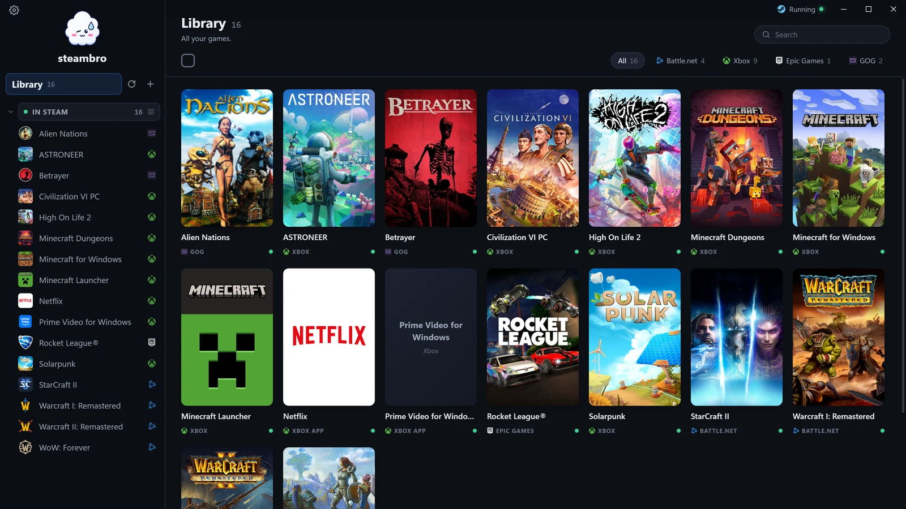
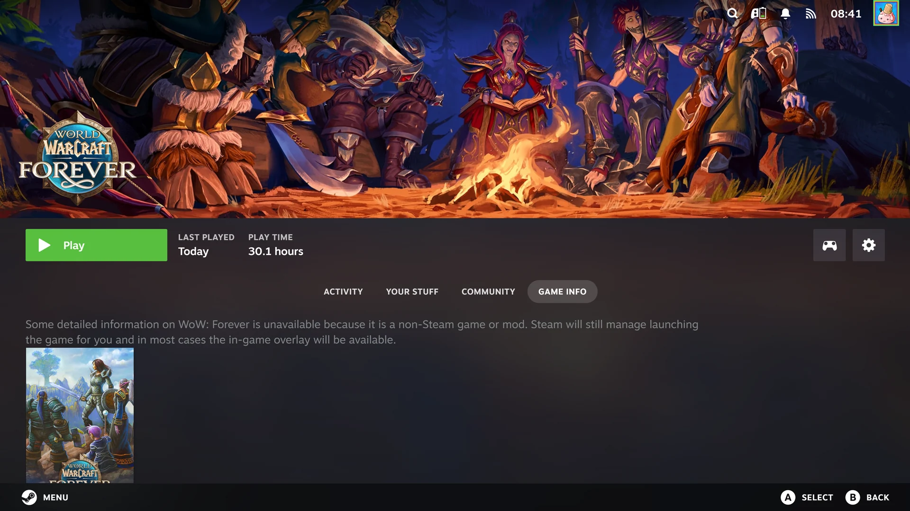
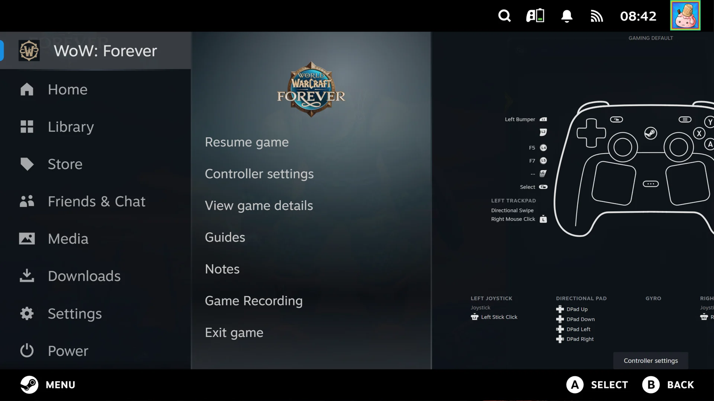
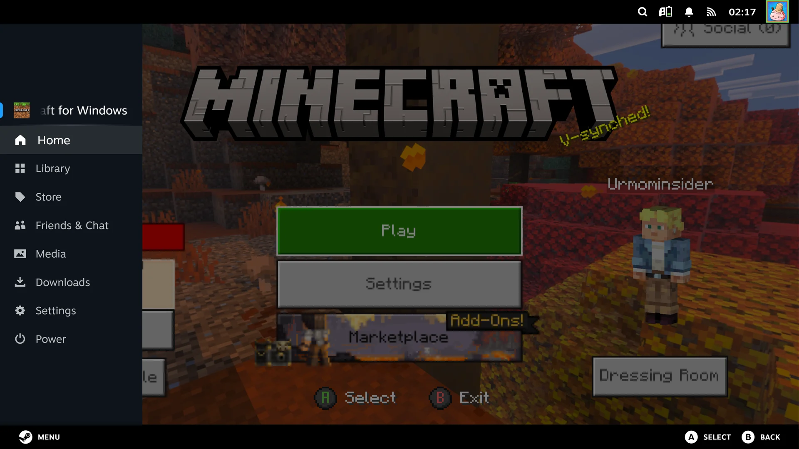
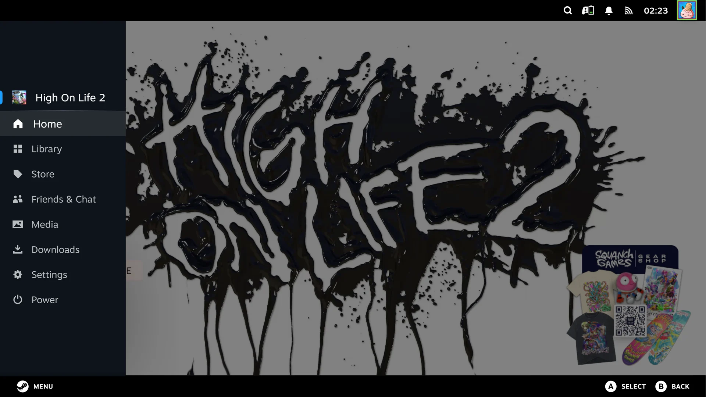
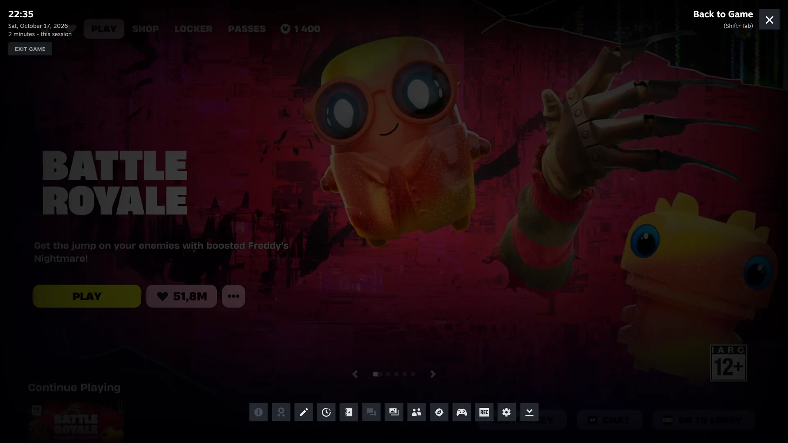
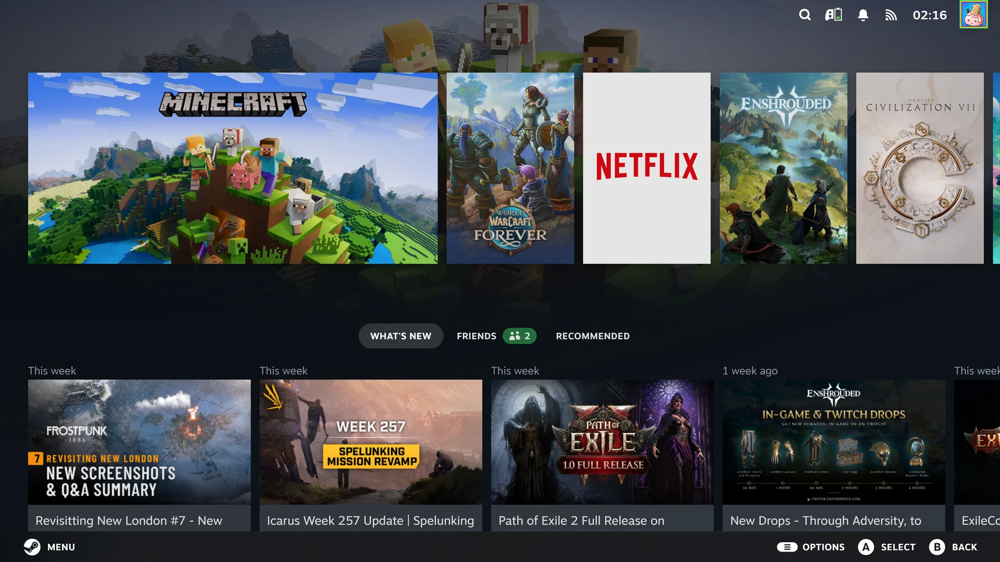
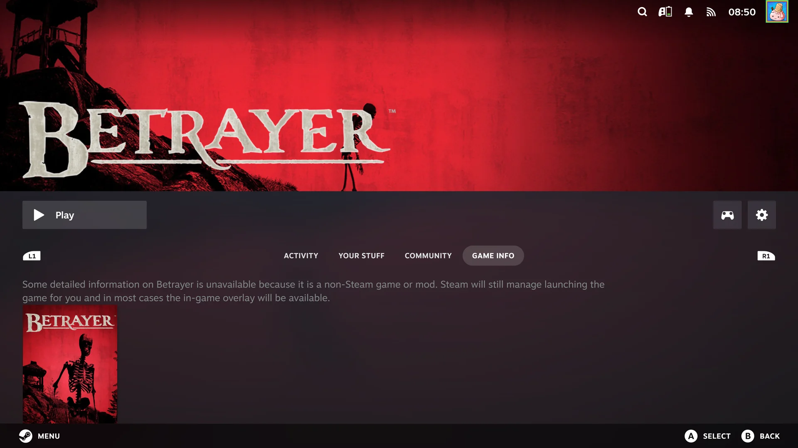

<p align="center"><a href="README.md">English</a> · <a href="README.ru.md">Русский</a> · <a href="README.es.md">Español</a> · <a href="README.pt-BR.md">Português (Brasil)</a></p>

<p align="center"></p>

<h1 align="center">steambro</h1>

<p align="center">Add Game Pass, Epic Games, Battle.net and GOG games to Steam, with Steam Input and the Steam overlay.<br>
Windows 10 and 11. Not for Steam Deck, Linux or macOS. Free and open source under the <a href="LICENSE">GPL-3.0</a>.</p>

<p align="center">
  <a href="https://github.com/shalamowww/steambro/releases/latest"><b>Download for Windows</b></a> ·
  <a href="https://steambro.app">steambro.app</a> ·
  <a href="#how-it-works">How it works</a>
</p>



Press Play in Steam or Big Picture. The game starts, and Steam counts the playtime.

**[WoW: Forever on a Steam Controller](https://steambro.app/wow-forever).** WoW: Forever has its own gamepad support. steambro adds Steam Input on top (trackpads, gyro, back buttons), the Steam overlay and Battle.net's artwork.

<p align="center">
  
  
</p>

## Install

1. Get it on the [Microsoft Store](https://apps.microsoft.com/detail/9NQVZ9CVTG85), or download it from [Releases](https://github.com/shalamowww/steambro/releases/latest).
2. Run it. If Windows SmartScreen warns about the GitHub download, select More info, then Run anyway.
3. Select your games, then Add to Steam. Steam restarts once.

The Microsoft Store version is the same app, paid. The Store keeps it updated, and the price goes to development.

## Stores and controllers

- **[Game Pass and the Xbox app](https://steambro.app/game-pass):** your Steam Input layout and the Steam overlay work.
- **[Epic Games](https://steambro.app/epic-games):** your layout and the Steam overlay work, with no driver.
- **[Battle.net](https://steambro.app/battle-net):** the same, in WoW: Forever and every installed Blizzard game.
- **[GOG](https://steambro.app/gog):** the same, except in a game that runs as administrator.
- **Any exe:** select +, then the exe. It works like a GOG game.
- **[Netflix, Apple TV and Prime Video](https://steambro.app/netflix):** apps from the Xbox app open from Steam.

Any controller that Steam Input supports works in Epic Games, Battle.net and GOG games. Game Pass games differ:

- Xbox controllers need nothing.
- For a [Steam Controller](https://steambro.app/steam-controller), [DualSense (PS5 controller)](https://steambro.app/ps5-controller), DualShock 4 or Switch Pro, install the free [ViGEmBus driver](https://steambro.app/driver).
- The game shows Xbox button prompts.
- Only the Steam Controller is tested there, without its gyro, trackpads and back buttons.

<p align="center">
  
  
  
</p>

## What you get

- **Your Steam Input layout:** trackpads, gyro and radial menus work in Epic Games, Battle.net and GOG games.
- **The Steam overlay:** Shift+Tab or the Steam button opens it over the game.
- **Big Picture:** your games sit beside your Steam games on the TV. The steambro window works with a controller too.
- **Artwork:** each game gets its store's artwork. [Adjust any crop, or use your own image](https://steambro.app/artwork).
- **Your own shortcuts:** steambro leaves alone a shortcut that you or UWPHook made. [Compare steambro with UWPHook, GlosSI and SISR](https://steambro.app/compare).

<p align="center">
  
  
</p>

## How it works

Steam gives Steam Input, the Steam overlay and playtime only to games it starts. So each shortcut starts steambro, which starts the game the way its store does.

## Does not work yet

- EA app and Ubisoft Connect games: steambro does not find them.
- In Game Pass games: Steam's notifications, screenshot key and FPS counter.

## Not possible

- Steam achievements: Steam has none for a shortcut.
- Playing with Steam closed: your layout and the Steam overlay come from Steam.

## Bug reports and privacy

Select "Save a report for a bug" in Settings, About, and attach the file to an [issue](https://github.com/shalamowww/steambro/issues). steambro replaces your Windows user name, PC name and Steam account IDs in it.

steambro has no telemetry and no accounts. The [privacy page](https://steambro.app/privacy) lists what it reads and sends.

The [support page](https://steambro.app/support) lists ways to support steambro.

steambro is unofficial and not affiliated with Valve, Microsoft, Blizzard, Epic Games or GOG.

## Build from source

Everything installs per user, with nothing system-wide and no Visual Studio.

```text
scoop install mingw uv
scoop bucket add extras
scoop install nsis
```

- Rust comes through [rustup](https://rustup.rs). [rust-toolchain.toml](rust-toolchain.toml) picks `stable-x86_64-pc-windows-gnu`, which rustup installs at the first `cargo` command.
- mingw provides `windres`, which puts the icon and the manifest into the exe, and `dlltool`. Open a new terminal after installing it.
- uv runs the Python scripts with a Python of its own.
- NSIS builds the installer. Only `release.ps1` needs it.

`cargo build` and `cargo test` work as usual. With the GNU toolchain, Tauri needs `WebView2Loader.dll` beside the exe, and both scripts copy it from the `webview2-com-sys` crate.

## The scripts

| Command | Effect |
| --- | --- |
| `cargo test` | Runs the unit tests. They include a read-only round trip of this PC's `shortcuts.vdf` files and an end-to-end add into a scratch account folder. |
| `scripts\dev.ps1` | Builds steambro, copies it with the loader to `%LOCALAPPDATA%\steambro-dev`, and starts the tray app there. Blocks until "Quit steambro". |
| `scripts\dev.ps1 -Restart` | Ends the running tray app, deploys the new build, and starts the tray app again in the background. |
| `scripts\dev.ps1 list -v` | Runs a command and prints its output. |
| `scripts\release.ps1` | Builds the release exe and writes `steambro-v<version>-windows-x64.zip` and `steambro-v<version>-windows-x64-setup.exe` to `target\release\`. The version is the one in [Cargo.toml](Cargo.toml) with a fourth number, 0, as the Microsoft Store writes it; the release tag is `v<version>`. |
| `uv run scripts\icons.py` | Draws the steambro cloud and writes every icon file. It needs `cargo install resvg` once. Rebuild afterwards, because the exe contains the icons. |
| `uv run scripts\check_i18n.py` | Compares the window's text files, `ui/i18n/<code>.json`, with English: keys, placeholders and plural forms. |

Build a release from a clean export of the commit, not from the working folder, because the exe holds the `ui` folder as it is:

```text
git archive -o target\export-<commit>.tar <commit>
mkdir target\export-<commit>; tar -x -f target\export-<commit>.tar -C target\export-<commit>
cd target\export-<commit>; scripts\release.ps1
```

## Repository layout

- `src/`: the program, in Rust. One exe is the tray app, the `launch` command that each shortcut runs, and a small command line (`steambro list`). Each store is a module under `src/library/`.
- `ui/`: the window, in plain HTML, CSS and JavaScript with no build step. `build.rs` embeds it into the exe. `ui/i18n/<code>.json` holds every text of the window, the tray and the notifications, one file per language.
- `scripts/`: the scripts above and `installer.nsi`, the installer.
- `icons/`: the app and tray icons that `icons.py` draws.
- `media/`: the screenshots on this page.
- `vendor/vigem-client/`: the ViGEm client crate with steambro's one change.
- `capabilities/` and `tauri.conf.json`: Tauri's permission file and the window's settings.

## Contributing

Bug reports, translations and fixes are welcome. [CONTRIBUTING.md](CONTRIBUTING.md) says how: a report for a bug comes from Settings, About; a translation is one file in `ui/i18n/`; a code change starts with an issue.

## Credits

Virtual controllers: [ViGEmBus](https://github.com/nefarius/ViGEmBus) by Nefarius Software Solutions, through [vigem-client](https://github.com/CasualX/vigem-client) by Casper (MIT), with a small change in `vendor/vigem-client`. The stores' logos come from [Simple Icons](https://simpleicons.org) (CC0); steambro shows them only to name each store.

## License

[GPL-3.0](LICENSE).
