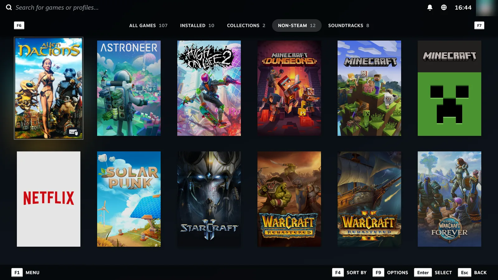
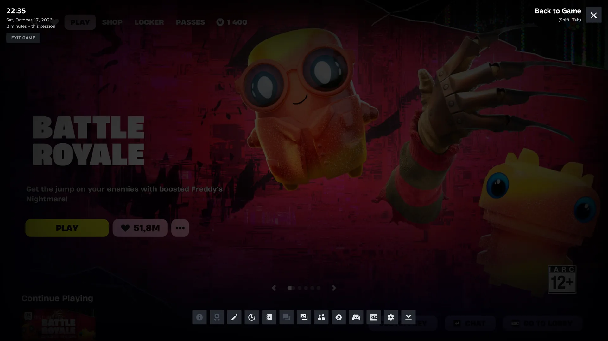
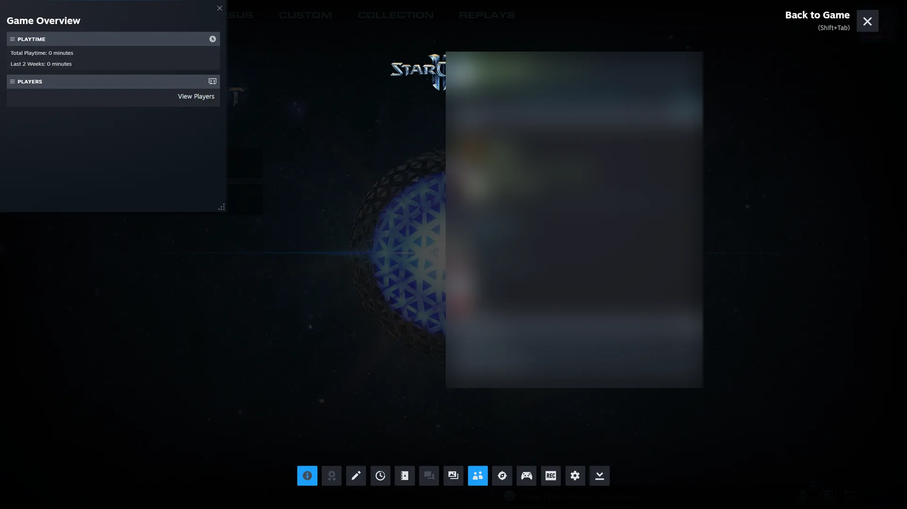
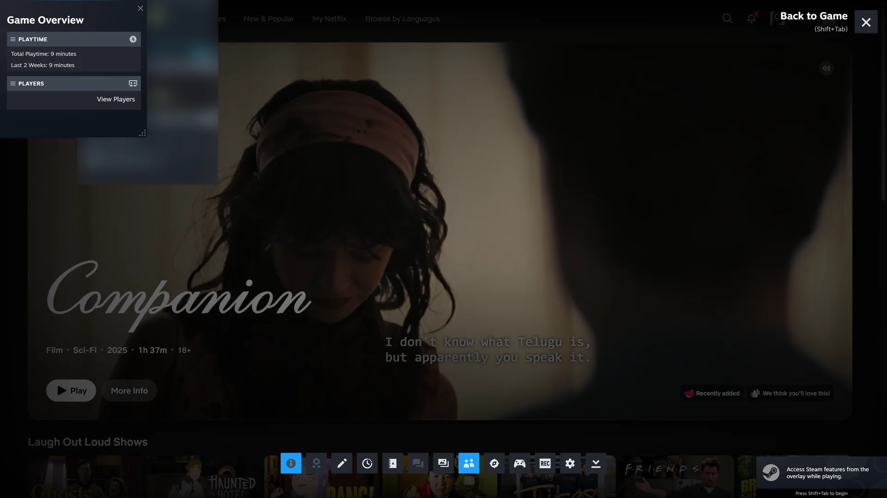
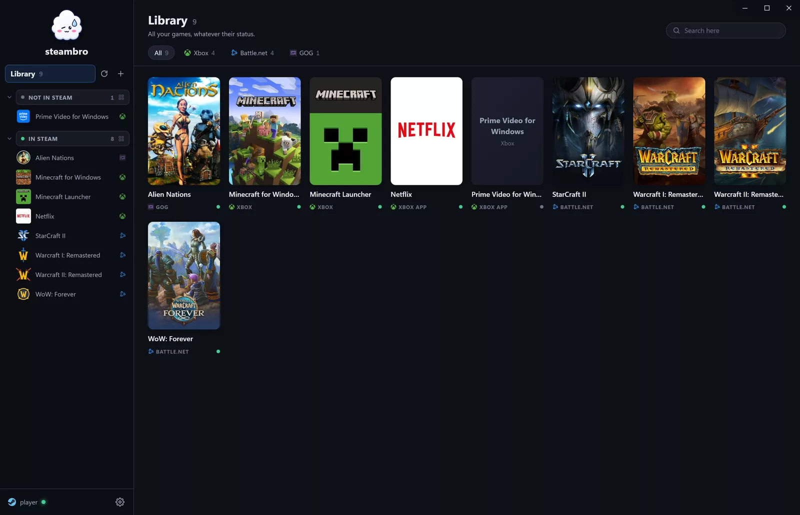
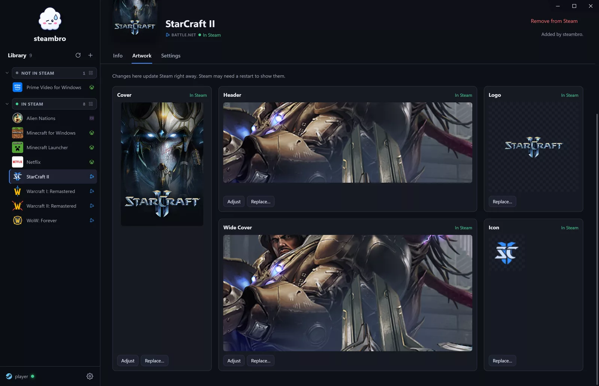
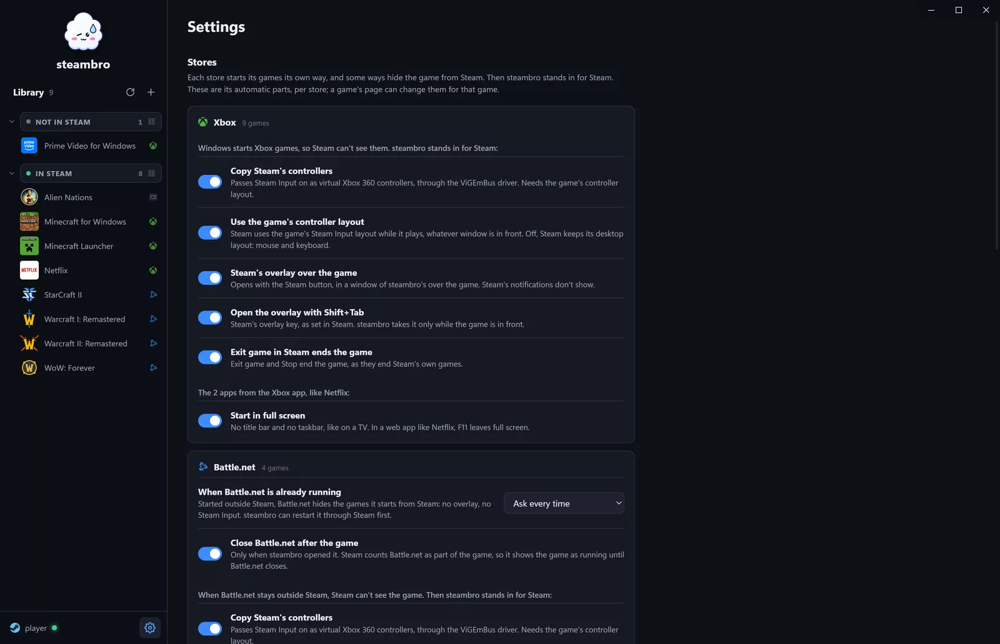
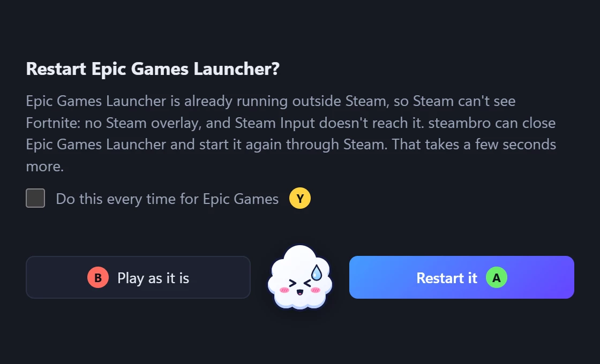
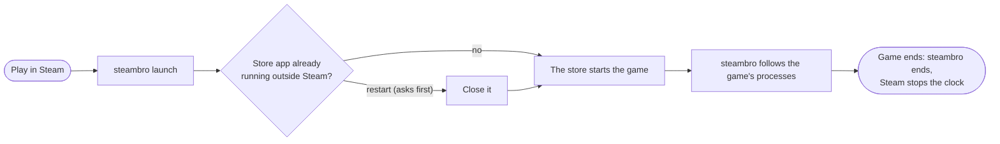

<p align="center"></p>

<h1 align="center">steambro</h1>

<p align="center"><b>All your games in Steam. Done properly.</b><br>
Real artwork, playtime, Steam's overlay, and Steam Input. Xbox games too.</p>

<p align="center">
  <a href="https://github.com/shalamowww/steambro/releases/latest"><b>Download</b></a> ·
  <a href="https://steambro.app">steambro.app</a> ·
  <a href="#how-it-works">How it works</a>
</p>



**steambro** finds the games your other stores installed and adds them to Steam. You press Play in Steam, and the game starts the way its store starts it. Steam counts the playtime. Big Picture gets one library.

Mouse and keyboard work as usual. A controller is optional.

Unofficial. Not affiliated with Valve, Microsoft, Blizzard, Epic Games, or GOG.

## What you get

- **Your games, found.** Xbox and Game Pass, Battle.net, Epic Games, GOG, and apps from the Xbox app like Netflix and Apple TV. **steambro** reads each store's records. It never scans your disk.
- **Anything else, by its exe.** Press +, pick the exe. It gets its icon and a name from its folder.
- **New installs, noticed.** Install a game, and a Windows notification offers to add it.
- **Real artwork.** Cover, header, logo, wide cover, and icon, from the store itself. Adjust any crop, or use your own image.
- **Launches that Steam follows.** Steam shows the game as running and counts the time. A store app that **steambro** opened closes after the game.
- **Steam's overlay everywhere.** Shift+Tab or the Steam button: friends, chat, browser, controller settings. Xbox games too.
- **Steam Input in Xbox games.** Your Steam layout reaches the game: radial menus, gyro, trackpads.
- **Exit game works.** One Stop in Steam ends the game. Xbox games too.
- **Apps in full screen.** Netflix and the other apps open without a title bar or taskbar, like on a TV.
- **Store quirks, handled.** Battle.net or the Epic Games Launcher already open? Then Steam can't see the game. **steambro** asks once and restarts it through Steam.
- **Every automatic part is a setting.** Defaults that fit most games. A switch per store, an override per game, and every timing.
- **Big libraries.** Search, tags, multi-select. Add, update, or remove many games at once, for one Steam account or all of them.



| StarCraft II, from Battle.net | Netflix, from the Xbox app |
| --- | --- |
|  |  |

| The library, by status | A game's artwork |
| --- | --- |
|  |  |

| Settings per store | The question at a launch |
| --- | --- |
|  |  |

## Install

1. Download from [Releases](https://github.com/shalamowww/steambro/releases/latest): the installer (`-setup.exe`) or the portable zip. No admin rights.
2. The files aren't signed yet. If SmartScreen warns, choose "More info", then "Run anyway".
3. Choose "Add N games to Steam". Steam restarts once.
4. For non-Xbox controllers in Xbox games, like the Steam Controller: get the free [ViGEmBus driver](https://steambro.app/driver). The settings tell you when you need it.

Needs Windows 10 or 11, Steam, and WebView2 (Windows 11 has it; Windows 10 gets it with Edge).

## How it works

Steam hooks into every process it starts. That hook is how Steam Input reaches a game, how the overlay draws, and how Steam counts playtime. Add a launcher to Steam by hand, and Steam follows the launcher, not the game: one controller layout for all its games, playtime while the launcher is open, and nothing at all when the launcher already ran. Xbox games are worse: Windows starts them, never Steam.

So every shortcut runs **steambro**, and Steam hooks it. **steambro** starts the game the store's way and stays until the game ends:



- **Battle.net and Epic Games:** **steambro** opens the store app inside Steam's launch, so the game gets Steam's hook.
- **GOG and added exes:** **steambro** starts the exe itself, so the game gets Steam's hook.
- **Xbox games and apps:** Windows starts them, outside Steam's hook. So **steambro** stands in for Steam:
  - **Controllers:** Steam uses the game's layout, and **steambro** copies Steam Input to a virtual Xbox 360 controller. Non-Xbox controllers need the free ViGEmBus driver for this; Xbox controllers don't.
  - **Overlay:** Steam puts its overlay into **steambro**, not into the game. So **steambro** gives the overlay a window over the game, which shows only while the overlay is open.
- **Exit, for every game:** when Steam ends **steambro**, Windows ends the game with it, and the store app it opened.

## Build from source

From WSL with the mingw-w64 cross toolchain:

```text
scripts/win.sh            # build and start the tray app on Windows
scripts/win.sh --test     # run the tests on Windows
scripts/release.sh        # build the release zip and installer
```

On Windows with Rust and the MSVC toolchain: `cargo build --release`.

## Status

**Early alpha.** Next up: more stores, rumble, and more Steam layout features.

## Credits

Virtual controllers: [ViGEmBus](https://github.com/nefarius/ViGEmBus) by Nefarius Software Solutions.

## License

[GPL-3.0](LICENSE).
