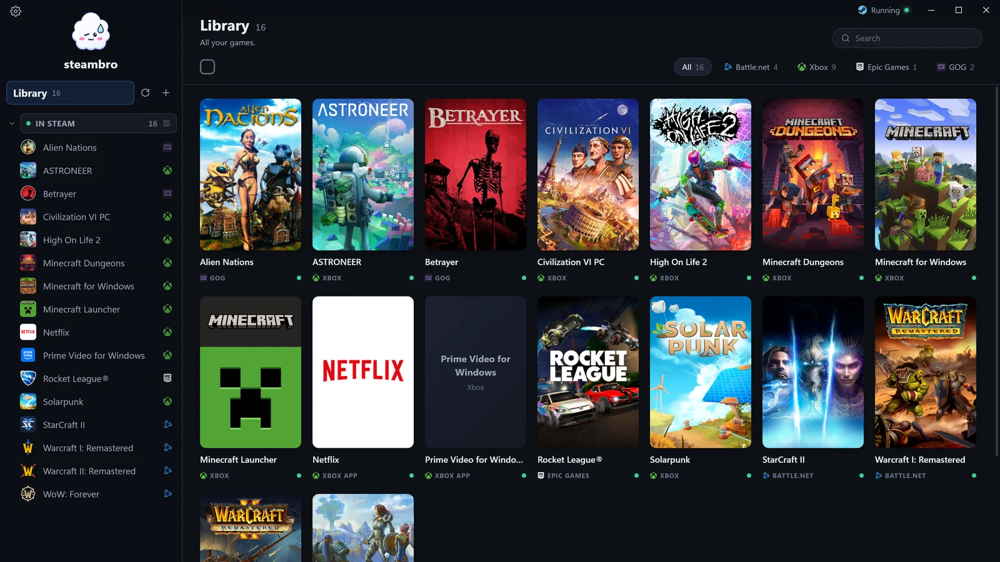
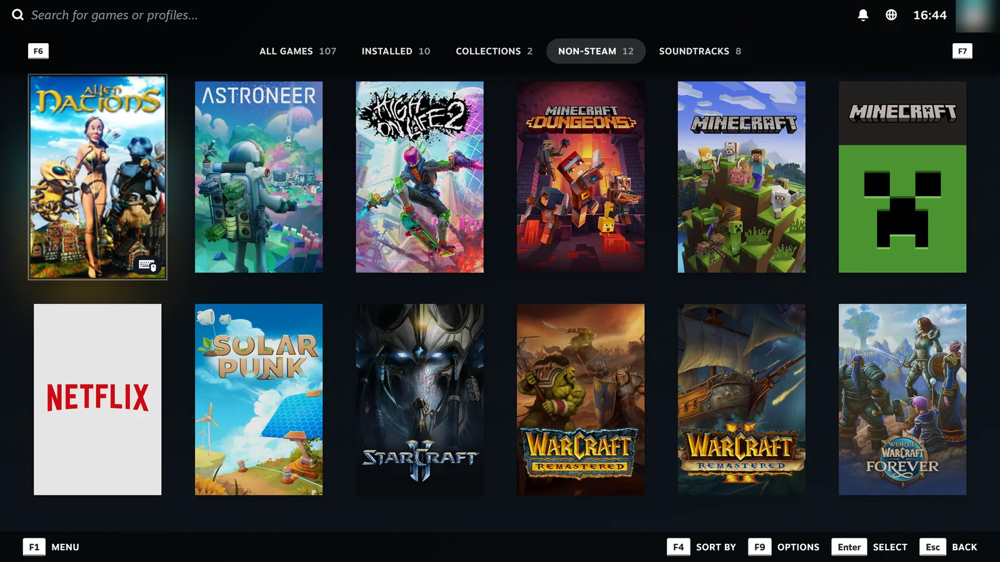
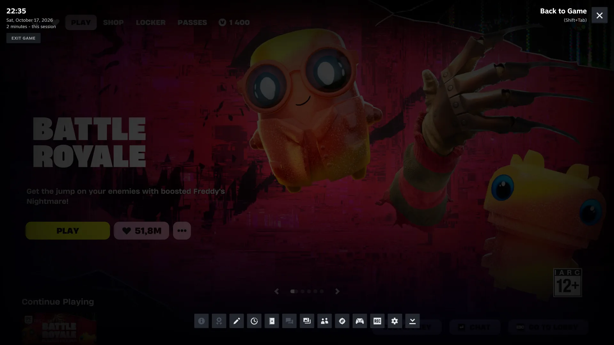
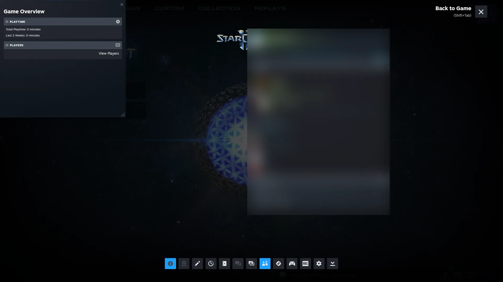
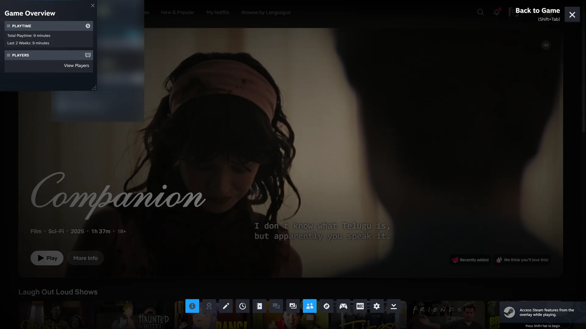
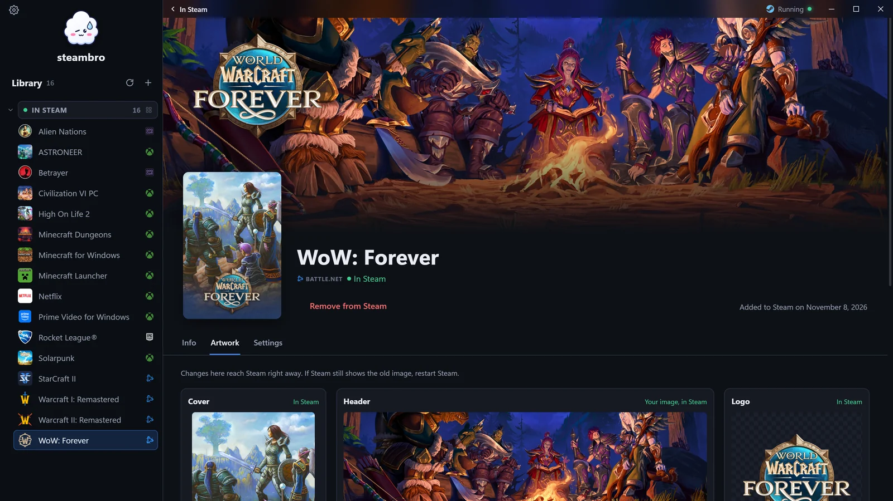
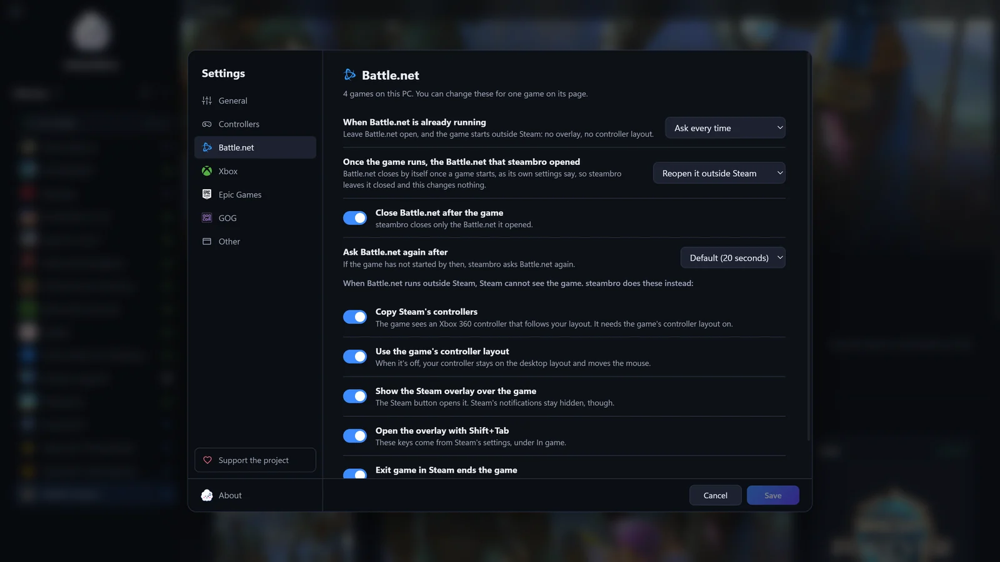
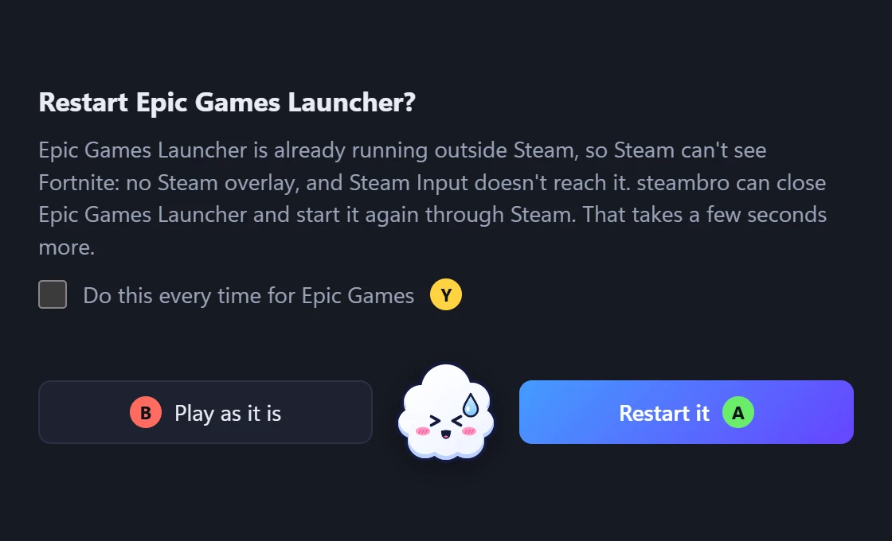
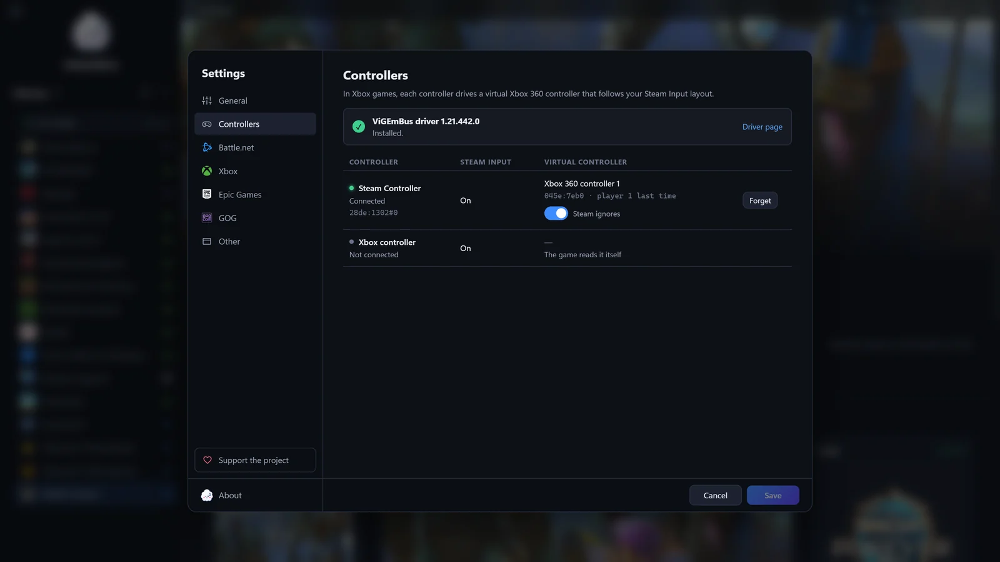
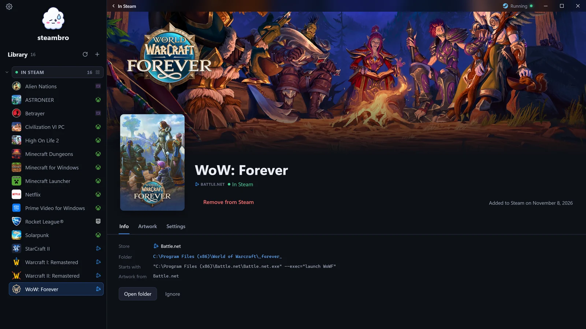

<p align="center"><a href="README.md">English</a> · <a href="README.ru.md">Русский</a> · <a href="README.es.md">Español</a> · <a href="README.pt-BR.md">Português (Brasil)</a></p>

<p align="center"></p>

<h1 align="center">steambro</h1>

<p align="center">O steambro adiciona seus jogos do Game Pass, da Epic, do Battle.net e da GOG ao Steam, para sua configuração do Steam Input e a Sobreposição do Steam funcionarem neles.<br>
Windows 10 e 11. Não serve para Steam Deck, Linux nem macOS. Software livre sob a <a href="LICENSE">GPL-3.0</a>.</p>

<p align="center">
  <a href="https://github.com/shalamowww/steambro/releases/latest"><b>Baixar para Windows</b></a> ·
  <a href="https://steambro.app/pt-br/">steambro.app</a> ·
  <a href="#como-funciona">Como funciona</a>
</p>



Aperte Jogar no Steam, na área de trabalho ou no Big Picture, e o jogo abre do jeito que a loja dele abre. O Steam mostra o jogo rodando e conta o tempo de jogo. Qualquer controle que o Steam Input suporta funciona em jogos da Epic, do Battle.net e da GOG. Mouse e teclado funcionam também. O steambro não é oficial e não tem vínculo com a Valve, a Microsoft, a Blizzard, a Epic Games nem a GOG.

## Instalar

1. Compre na [Microsoft Store](https://apps.microsoft.com/detail/9NQVZ9CVTG85), ou baixe o instalador (`-setup.exe`) ou o zip portátil em [Releases](https://github.com/shalamowww/steambro/releases/latest). Não precisa de permissão de administrador.
2. Abra o steambro. Se o Windows SmartScreen avisar sobre a versão do GitHub, selecione Mais informações e depois Executar assim mesmo.
3. Selecione seus jogos, depois Adicionar ao Steam. O Steam reinicia uma vez.
4. Se você usa controle que não é Xbox em jogos do app Xbox, instale o [driver ViGEmBus](https://steambro.app/pt-br/driver) grátis. As configurações avisam quando.

## Lojas e controles

O steambro acha os jogos que você instalou. Ele lê os registros de cada loja e nunca varre seu disco.

- [App Xbox e Game Pass](https://steambro.app/pt-br/game-pass): sua configuração do Steam Input e a Sobreposição do Steam funcionam nos jogos do app Xbox.
- [Epic Games](https://steambro.app/pt-br/epic-games): o Epic Games Launcher abre por dentro do Steam, então o Steam enxerga o jogo e a sobreposição funciona.
- [Battle.net](https://steambro.app/pt-br/battle-net): o steambro acha todo jogo da Blizzard instalado, betas e reinos de teste também, e abre o Battle.net por dentro do Steam.
- [GOG](https://steambro.app/pt-br/gog): o steambro abre o jogo ele mesmo, com a arte da própria GOG, então o GOG Galaxy pode ficar fechado.
- [Apps no app Xbox](https://steambro.app/pt-br/netflix): Netflix e Apple TV abrem pelo Steam em tela cheia.
- Qualquer exe: selecione +, depois o exe, e o jogo ganha o próprio ícone e um nome a partir da pasta.

Controle Xbox funciona direto, sem instalar nada. Nos jogos do app Xbox, [Steam Controller](https://steambro.app/pt-br/steam-controller), [DualSense](https://steambro.app/pt-br/ps5-controller), DualShock 4 ou Switch Pro precisa do [driver ViGEmBus](https://steambro.app/pt-br/driver) grátis, e o jogo mostra os ícones de botão do Xbox. Desses, só o Steam Controller foi testado nesses jogos até agora. Jogos da Epic, do Battle.net e da GOG não precisam de nada a mais.

## O que você ganha

- **Um botão Jogar com a arte de verdade:** cada jogo ganha um atalho próprio no Steam, com a arte da própria loja recortada nos tamanhos do Steam. [Ajuste o recorte, ou use sua própria imagem](https://steambro.app/pt-br/artwork).
- **Sua configuração do Steam Input no jogo:** em jogos da Epic, do Battle.net e da GOG, trackpads, giroscópio e menus radiais seguem a configuração que você definiu no Steam.
- **A Sobreposição do Steam e o tempo de jogo:** Shift+Tab ou o botão Steam abre a sobreposição por cima do jogo. O Steam mostra o jogo rodando e conta o tempo de jogo.
- **Jogue do sofá:** seus jogos de todas as lojas ficam no Big Picture com a arte deles: escolha um na TV e aperte Jogar. A janela do steambro funciona com controle também.
- **Atalhos que você fez ficam como estão:** um atalho que você ou o UWPHook fez aparece em "Adicionados sem o steambro", e o steambro não mexe nele. [Compare o steambro com UWPHook, GlosSI e SISR](https://steambro.app/pt-br/compare).

**[WoW: Forever no Steam Controller](https://steambro.app/pt-br/wow-forever).** WoW: Forever tem suporte próprio a gamepad. O steambro coloca o Steam Input por cima: trackpads, giroscópio, botões traseiros e a Sobreposição do Steam, com a arte do próprio Battle.net. Adicione o jogo, ligue Gamepad nas opções dele e aperte Jogar no Steam.



| A Sobreposição do Steam sobre Fortnite, da Epic Games | A Sobreposição do Steam sobre StarCraft II, do Battle.net |
| --- | --- |
|  |  |

| A Sobreposição do Steam sobre a Netflix, em tela cheia | A arte de WoW: Forever no steambro |
| --- | --- |
|  |  |

| As configurações do Battle.net: tudo que é automático dá para configurar | A pergunta quando o Epic Games Launcher já está aberto |
| --- | --- |
|  |  |

| Configurações, Controles: qual controle comanda qual | A página de WoW: Forever, com a arte do próprio Battle.net |
| --- | --- |
|  |  |

## Como funciona

O Steam só dá o Steam Input, a Sobreposição do Steam e o tempo de jogo aos jogos que ele mesmo abre. Então cada atalho abre o steambro, que abre o jogo do jeito que a loja dele abre.

## Ainda não funciona

- Jogos do EA app e do Ubisoft Connect: o steambro não acha esses.
- Nos jogos do Game Pass: as notificações, a tecla de captura de tela e o contador de FPS do Steam.

## Não é possível

- Conquistas do Steam: o Steam não tem conquista para atalho.
- Jogar com o Steam fechado: sua configuração de controle e a Sobreposição do Steam vêm do Steam.

## Status e relatórios de erro

**Primeira versão**, 1.0.0.0. O que vem aí: mais lojas e mais recursos da configuração de controle do Steam.

Quando algo der errado, selecione "Salvar um relatório de erro" no menu da bandeja ou em Configurações, Sobre, e anexe o arquivo a uma [issue](https://github.com/shalamowww/steambro/issues). O relatório traz as configurações do steambro e o que elas fazem com cada jogo. Ele também inclui as configurações do Steam e das lojas que importam, e o fim dos logs. Seu nome de usuário do Windows, o nome do PC e os IDs de conta Steam são trocados. Dê uma olhada antes de anexar.

O steambro não tem telemetria, análise de uso nem conta. A [página de privacidade](https://steambro.app/pt-br/privacy) lista o que ele lê e envia. A [página de apoio](https://steambro.app/pt-br/support) mostra como retribuir.

## Compilar a partir do código-fonte

Tudo se instala por usuário, sem nada no sistema inteiro e sem Visual Studio.

```text
scoop install mingw uv
scoop bucket add extras
scoop install nsis
```

- O Rust vem pelo [rustup](https://rustup.rs). O [rust-toolchain.toml](rust-toolchain.toml) escolhe `stable-x86_64-pc-windows-gnu`, que o rustup instala no primeiro comando `cargo`.
- O mingw fornece o `windres`, que coloca o ícone e o manifesto no exe, e o `dlltool`. Abra um terminal novo depois de instalá-lo.
- O uv executa os scripts Python com um Python próprio.
- O NSIS monta o instalador. Só o `release.ps1` precisa dele.

`cargo build` e `cargo test` funcionam como de costume. Com o toolchain GNU, o Tauri precisa do `WebView2Loader.dll` ao lado do exe, e os dois scripts o copiam do crate `webview2-com-sys`.

## Os scripts

| Comando | Efeito |
| --- | --- |
| `cargo test` | Executa os testes unitários. Eles incluem uma ida e volta só de leitura dos arquivos `shortcuts.vdf` deste PC e uma adição de ponta a ponta em uma pasta de conta de teste. |
| `scripts\dev.ps1` | Compila o steambro, copia o exe e o loader para `%LOCALAPPDATA%\steambro-dev` e abre o app da bandeja lá. Bloqueia até "Sair do steambro". |
| `scripts\dev.ps1 -Restart` | Fecha o app da bandeja que está rodando, copia a build nova e abre o app da bandeja de novo em segundo plano. |
| `scripts\dev.ps1 list -v` | Executa um comando e imprime a saída dele. |
| `scripts\release.ps1` | Compila o exe de release e grava `steambro-v<version>-windows-x64.zip` e `steambro-v<version>-windows-x64-setup.exe` em `target\release\`. A versão é a do [Cargo.toml](Cargo.toml) com um quarto número, 0, como a Microsoft Store escreve; a tag da versão é `v<version>`. |
| `uv run scripts\icons.py` | Desenha a nuvem do steambro e grava todos os arquivos de ícone. Precisa de `cargo install resvg` uma vez. Recompile depois, porque o exe contém os ícones. |
| `uv run scripts\check_i18n.py` | Compara os arquivos de texto da janela, `ui/i18n/<code>.json`, com o inglês: chaves, placeholders e formas de plural. |

Monte um release a partir de uma exportação limpa do commit, não da pasta de trabalho, porque o exe guarda a pasta `ui` como ela está:

```text
git archive -o target\export-<commit>.tar <commit>
mkdir target\export-<commit>; tar -x -f target\export-<commit>.tar -C target\export-<commit>
cd target\export-<commit>; scripts\release.ps1
```

## Estrutura do repositório

- `src/`: o programa, em Rust. Um exe é o app da bandeja, o comando `launch` que cada atalho executa e uma pequena linha de comando (`steambro list`). Cada loja é um módulo em `src/library/`.
- `ui/`: a janela, em HTML, CSS e JavaScript puros, sem etapa de build. O `build.rs` a embute no exe. `ui/i18n/<code>.json` guarda todos os textos da janela, da bandeja e das notificações, um arquivo por idioma.
- `scripts/`: os scripts acima e o `installer.nsi`, o instalador.
- `icons/`: os ícones do app e da bandeja que o `icons.py` desenha.
- `media/`: as capturas de tela desta página.
- `vendor/vigem-client/`: o crate cliente do ViGEm com a única alteração do steambro.
- `capabilities/` e `tauri.conf.json`: o arquivo de permissões do Tauri e as configurações da janela.

## Contribuir

Relatórios de erro, traduções e correções são bem-vindos. O [CONTRIBUTING.md](CONTRIBUTING.md) diz como: um relatório de erro vem de Configurações, Sobre; uma tradução é um arquivo em `ui/i18n/`; uma mudança no código começa com uma issue.

## Créditos

Controles virtuais: [ViGEmBus](https://github.com/nefarius/ViGEmBus) da Nefarius Software Solutions, por meio do [vigem-client](https://github.com/CasualX/vigem-client) de Casper (MIT), com uma pequena alteração em `vendor/vigem-client`. Os logos das lojas vêm do [Simple Icons](https://simpleicons.org) (CC0); o steambro os mostra só para identificar cada loja.

## Licença

[GPL-3.0](LICENSE).
