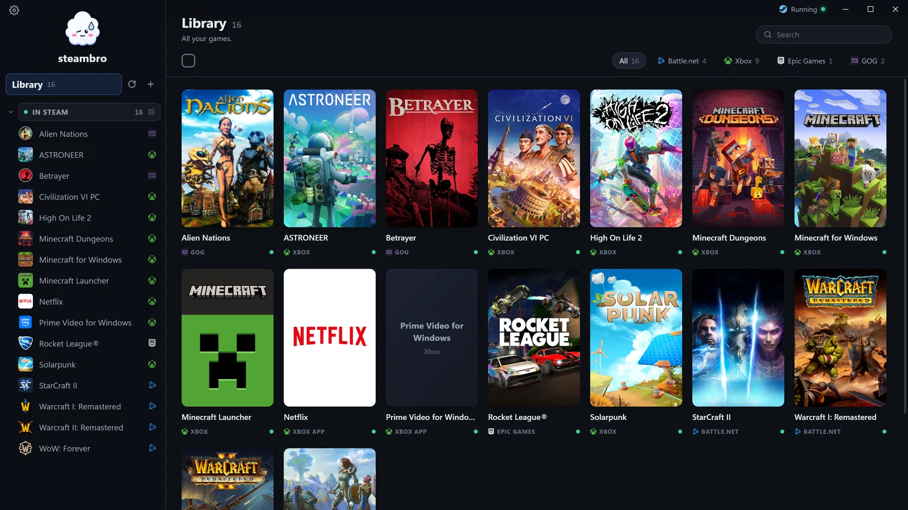
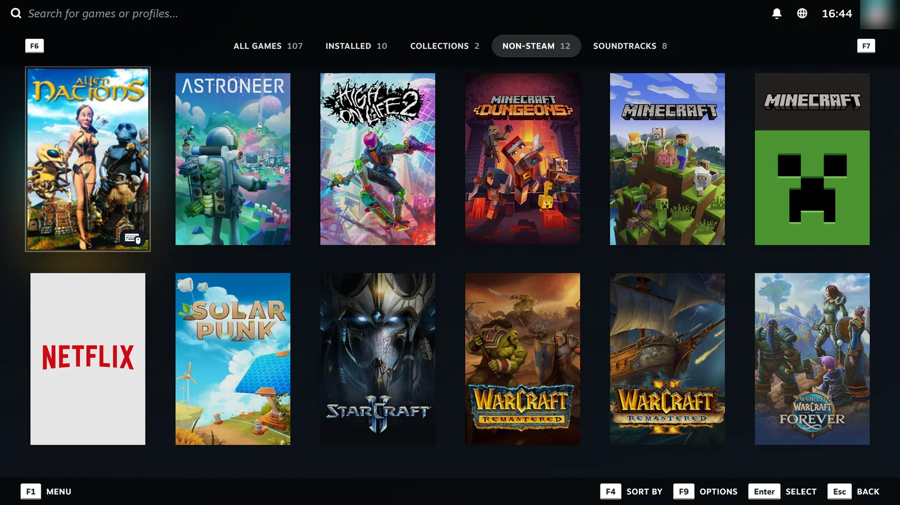
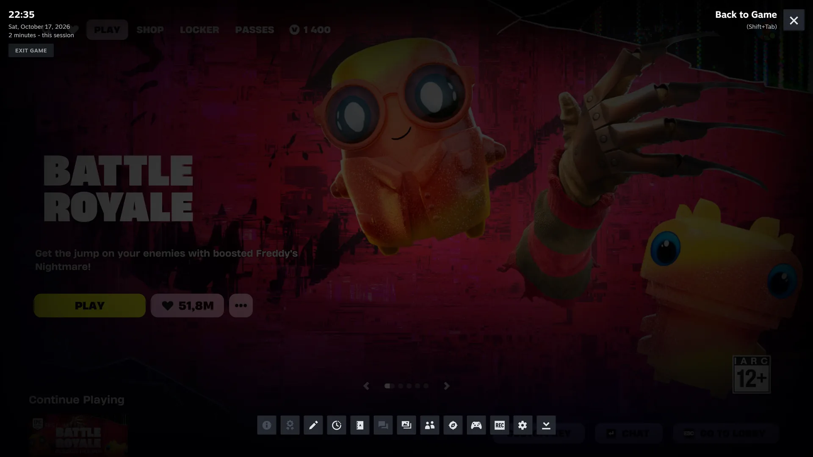
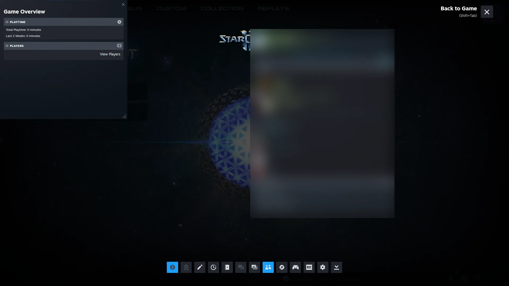
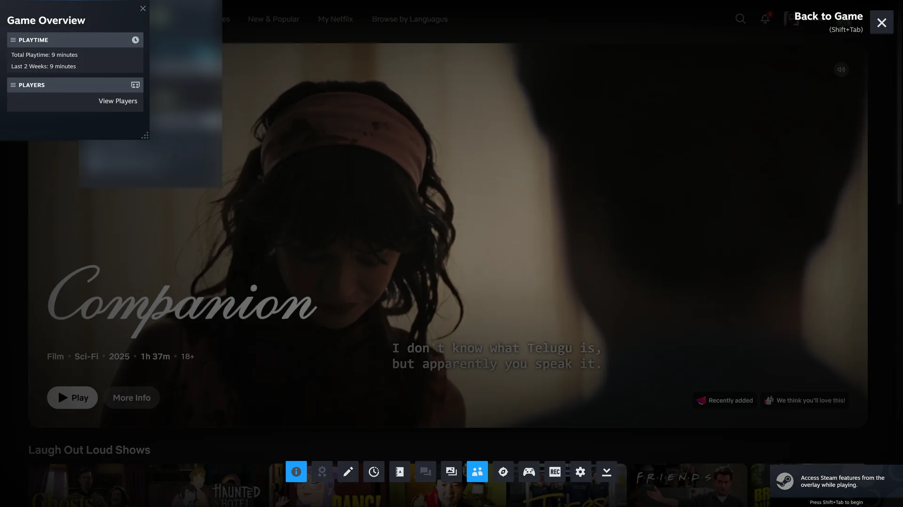
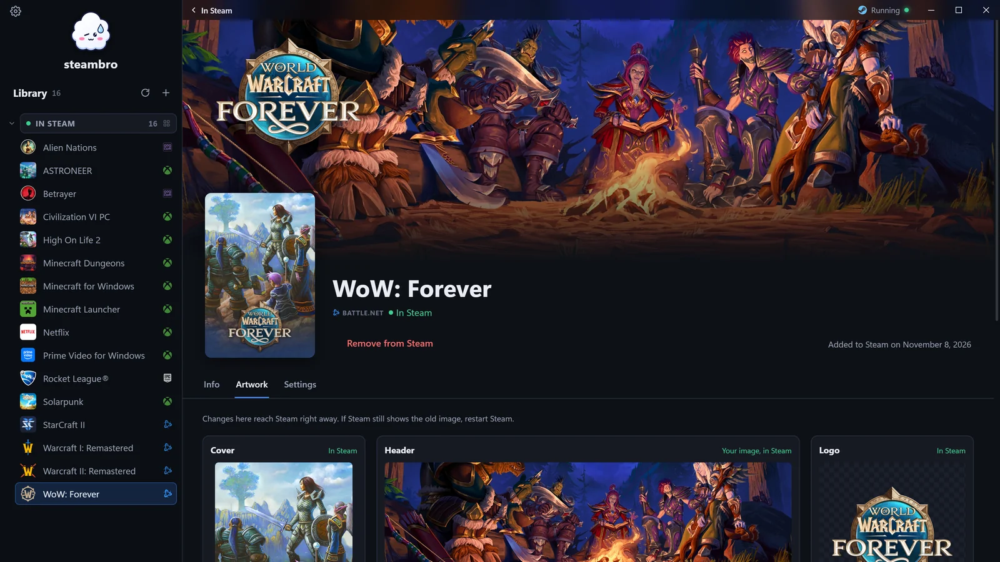
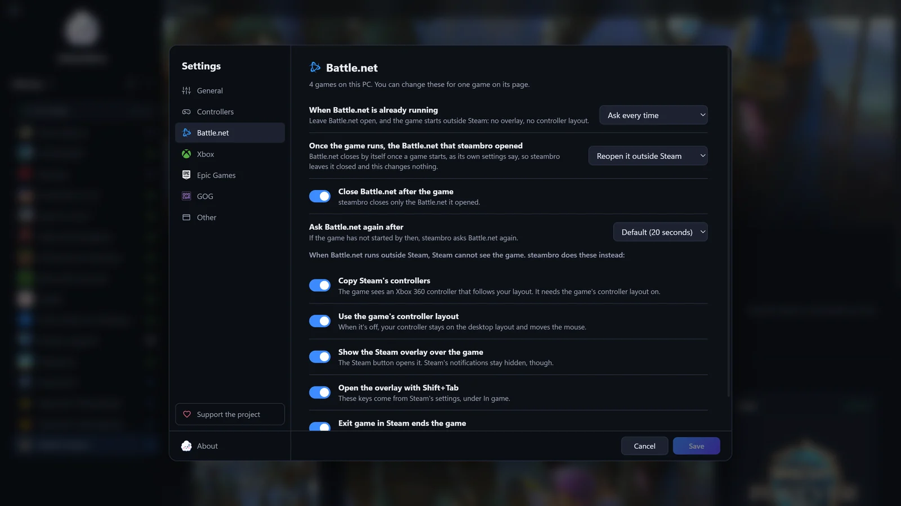
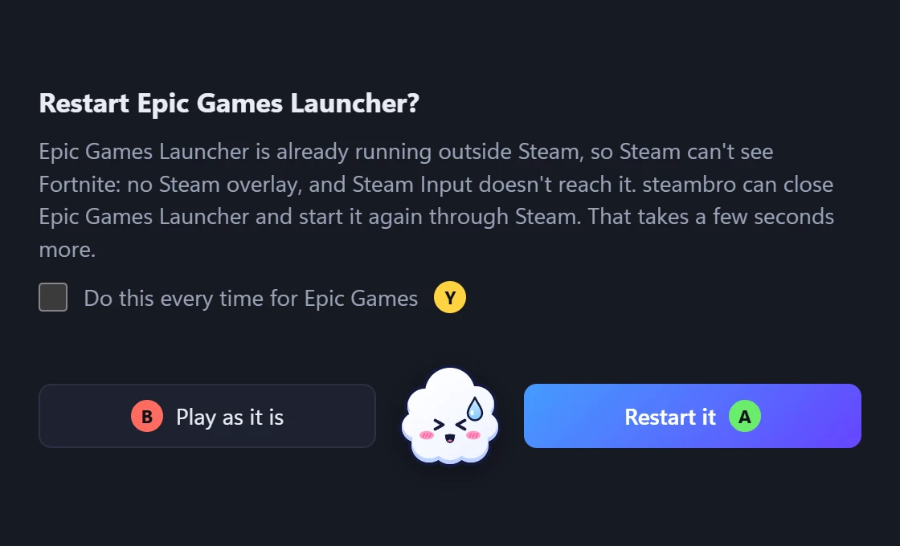
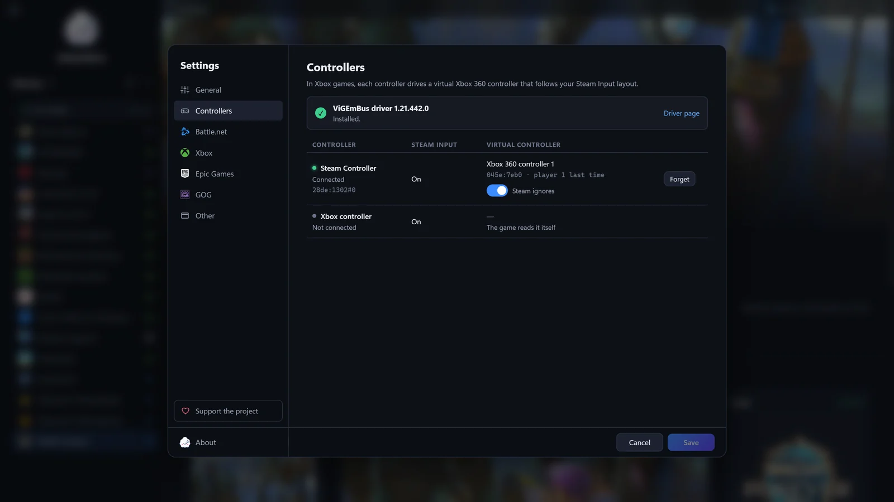
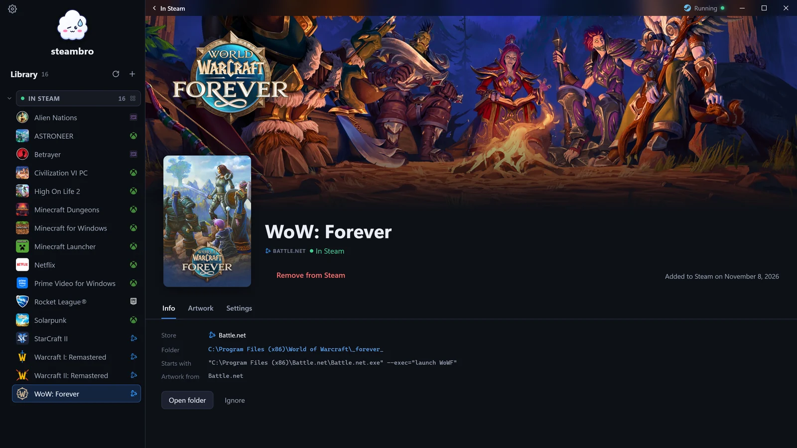

<p align="center"><a href="README.md">English</a> · <a href="README.ru.md">Русский</a> · <a href="README.es.md">Español</a> · <a href="README.pt-BR.md">Português (Brasil)</a></p>

<p align="center"></p>

<h1 align="center">steambro</h1>

<p align="center">steambro добавляет ваши игры из Epic, Battle.net, GOG и Game Pass в Steam, чтобы в них работали ваша раскладка Steam Input и оверлей Steam.<br>
Windows 10 и 11. Не для Steam Deck, Linux и macOS. Свободная программа под лицензией <a href="LICENSE">GPL-3.0</a>.</p>

<p align="center">
  <a href="https://github.com/shalamowww/steambro/releases/latest"><b>Скачать для Windows</b></a> ·
  <a href="https://steambro.app/ru/">steambro.app</a> ·
  <a href="#как-это-работает">Как это работает</a>
</p>



Нажмите «Играть» в Steam, на рабочем столе или в режиме Big Picture, и игра запустится так, как её запускает магазин. Steam показывает её запущенной и считает время в игре. В играх Epic, Battle.net и GOG работает любой контроллер, который поддерживает Steam Input. Мышь и клавиатура тоже работают. steambro — неофициальная программа, не связанная с Valve, Microsoft, Blizzard, Epic Games и GOG.

## Установка

1. Купите в [Microsoft Store](https://apps.microsoft.com/detail/9NQVZ9CVTG85) или скачайте установщик (`-setup.exe`) либо портативный zip из [Releases](https://github.com/shalamowww/steambro/releases/latest). Права администратора не нужны.
2. Запустите его. Если Windows SmartScreen ругается на сборку с GitHub, нажмите «Подробнее», затем «Выполнить в любом случае».
3. Отметьте игры, затем нажмите «Добавить в Steam». Steam перезапустится один раз.
4. Если вы играете в игры из приложения Xbox с контроллером не от Xbox, поставьте бесплатный [драйвер ViGEmBus](https://steambro.app/ru/driver). Настройки подскажут, когда.

## Магазины и контроллеры

steambro находит игры, которые вы установили. Он читает записи самих магазинов и никогда не сканирует диск.

- [Epic Games](https://steambro.app/ru/epic-games): Epic Games Launcher стартует внутри Steam, поэтому Steam видит игру, и оверлей работает. Epic больше не продаёт игры в России; бесплатные раздачи и уже купленные игры работают.
- [Battle.net](https://steambro.app/ru/battle-net): steambro находит все установленные игры Blizzard, беты и тестовые серверы тоже, и запускает Battle.net внутри Steam. Из России вход в Battle.net иногда не проходит; steambro на это не влияет.
- [GOG](https://steambro.app/ru/gog): steambro сам запускает игру, с родными изображениями GOG, поэтому GOG Galaxy можно не открывать. GOG больше не продаёт игры в России; купленные игры работают.
- Любой exe: нажмите «+», затем выберите exe, и игра получит иконку и имя из своей папки.
- [Приложения из приложения Xbox](https://steambro.app/ru/netflix): Netflix и Apple TV открываются из Steam на весь экран.
- [Приложение Xbox и Game Pass](https://steambro.app/ru/game-pass): ваша раскладка Steam Input и оверлей Steam работают в играх из приложения Xbox. PC Game Pass в России не продаётся; с играми, купленными в приложении Xbox, steambro работает так же.

Контроллерам Xbox настройка не нужна. В играх из приложения Xbox для [Steam Controller](https://steambro.app/ru/steam-controller), [DualSense](https://steambro.app/ru/ps5-controller), DualShock 4 и Switch Pro нужен бесплатный [драйвер ViGEmBus](https://steambro.app/ru/driver), и игра показывает подсказки кнопок Xbox. Из этих контроллеров в таких играх пока проверен только Steam Controller. Играм Epic, Battle.net и GOG ничего дополнительно не нужно.

## Что вы получаете

- **Кнопка «Играть» и родная обложка:** у каждой игры свой ярлык в Steam, а обложка, фон и логотип берутся из её магазина и подгоняются под размеры Steam. [Подгоните кадрирование или поставьте свою картинку](https://steambro.app/ru/artwork).
- **Ваша раскладка Steam Input в игре:** в играх Epic, Battle.net и GOG трекпады, гироскоп и радиальные меню слушаются раскладки, которую вы задали в Steam.
- **Оверлей Steam и время в игре:** Shift+Tab или кнопка Steam открывает оверлей поверх игры. Steam показывает игру запущенной и считает время в игре.
- **Играйте с дивана:** игры из всех ваших магазинов стоят в Big Picture со своими изображениями: выберите игру на телевизоре и нажмите «Играть». Окно steambro тоже работает с контроллером.
- **Ваши ярлыки остаются как есть:** ярлык, который сделали вы или UWPHook, показан в разделе «Добавлены вне steambro», и steambro его не трогает. [Сравните steambro с UWPHook, GlosSI и SISR](https://steambro.app/ru/compare).

**[WoW: Forever на Steam Controller](https://steambro.app/ru/wow-forever).** У WoW: Forever своя поддержка контроллера. steambro добавляет сверху Steam Input: трекпады, гироскоп, задние кнопки и оверлей Steam, с родными изображениями из Battle.net. Добавьте игру, включите «Геймпад» в её настройках и нажмите «Играть» в Steam.



| Оверлей Steam поверх Fortnite из Epic Games | Оверлей Steam поверх StarCraft II из Battle.net |
| --- | --- |
|  |  |

| Оверлей Steam поверх Netflix на весь экран | Изображения WoW: Forever в steambro |
| --- | --- |
|  |  |

| Настройки Battle.net: всё автоматическое — это настройка | Вопрос, когда Epic Games Launcher уже открыт |
| --- | --- |
|  |  |

| «Настройки», «Контроллеры»: какой контроллер каким управляет | Страница WoW: Forever с изображениями из Battle.net |
| --- | --- |
|  |  |

## Как это работает

Steam даёт Steam Input, оверлей Steam и время в игре только играм, которые запускает сам. Поэтому каждый ярлык запускает steambro, а тот запускает игру так, как это делает её магазин.

## Пока не работает

- Игры EA app и Ubisoft Connect: steambro их не находит.
- В играх Game Pass: уведомления Steam, его клавиша скриншота и счётчик FPS.

## Невозможно

- Достижения Steam: у ярлыка их в Steam нет.
- Игра при закрытом Steam: ваша раскладка и оверлей Steam приходят из Steam.

## Статус и баги

**Первый релиз**, версия 1.0.0.0. Дальше: больше магазинов и больше возможностей раскладки Steam.

Если что-то сломалось, выберите «Сохранить отчёт об ошибке» в меню трея или в «Настройки», «О программе» и приложите файл к [issue](https://github.com/shalamowww/steambro/issues). В отчёте настройки steambro и то, что они дают для каждой игры, важные настройки Steam и магазинов и конец логов. Имя пользователя Windows, имя ПК и ID аккаунтов Steam в нём заменены. Прочитайте его, прежде чем приложить.

У steambro нет телеметрии, аналитики и аккаунтов. [Страница о конфиденциальности](https://steambro.app/ru/privacy) перечисляет, что он читает и отправляет. [Страница поддержки](https://steambro.app/ru/support) рассказывает, как отблагодарить.

## Сборка из исходного кода

Всё устанавливается для текущего пользователя, без системных установок и без Visual Studio.

```text
scoop install mingw uv
scoop bucket add extras
scoop install nsis
```

- Rust ставится через [rustup](https://rustup.rs). [rust-toolchain.toml](rust-toolchain.toml) выбирает `stable-x86_64-pc-windows-gnu`, который rustup устанавливает при первой команде `cargo`.
- mingw даёт `windres`, который кладёт иконку и манифест в exe, и `dlltool`. После установки откройте новый терминал.
- uv запускает скрипты Python со своим собственным Python.
- NSIS собирает установщик. Он нужен только `release.ps1`.

`cargo build` и `cargo test` работают как обычно. С GNU-тулчейном Tauri нужен `WebView2Loader.dll` рядом с exe, и оба скрипта копируют его из крейта `webview2-com-sys`.

## Скрипты

| Команда | Действие |
| --- | --- |
| `cargo test` | Запускает модульные тесты. Среди них проверка чтения и записи файлов `shortcuts.vdf` этого ПК без изменения самих файлов и сквозное добавление во временную папку аккаунта. |
| `scripts\dev.ps1` | Собирает steambro, копирует его с загрузчиком в `%LOCALAPPDATA%\steambro-dev` и запускает оттуда steambro в трее. Ждёт до «Закрыть steambro». |
| `scripts\dev.ps1 -Restart` | Завершает работающий steambro в трее, разворачивает новую сборку и запускает steambro в трее снова в фоне. |
| `scripts\dev.ps1 list -v` | Выполняет команду и печатает её вывод. |
| `scripts\release.ps1` | Собирает релизный exe и записывает `steambro-v<version>-windows-x64.zip` и `steambro-v<version>-windows-x64-setup.exe` в `target\release\`. Версия — та, что в [Cargo.toml](Cargo.toml), с четвёртым числом 0, как её пишет Microsoft Store; тег релиза — `v<version>`. |
| `uv run scripts\icons.py` | Рисует облако steambro и записывает все файлы иконок. Один раз нужен `cargo install resvg`. После этого пересоберите, потому что exe содержит иконки. |
| `uv run scripts\check_i18n.py` | Сравнивает текстовые файлы окна, `ui/i18n/<code>.json`, с английским: ключи, плейсхолдеры и формы множественного числа. |

Собирайте релиз из чистого экспорта коммита, а не из рабочей папки, потому что exe содержит папку `ui` как есть:

```text
git archive -o target\export-<commit>.tar <commit>
mkdir target\export-<commit>; tar -x -f target\export-<commit>.tar -C target\export-<commit>
cd target\export-<commit>; scripts\release.ps1
```

## Структура репозитория

- `src/`: программа на Rust. Один exe — это steambro в трее, команда `launch`, которую запускает каждый ярлык, и небольшая командная строка (`steambro list`). Каждый магазин — модуль в `src/library/`.
- `ui/`: окно на обычных HTML, CSS и JavaScript без этапа сборки. `build.rs` встраивает его в exe. В `ui/i18n/<code>.json` каждый текст окна, трея и уведомлений, по одному файлу на язык.
- `scripts/`: скрипты выше и `installer.nsi`, установщик.
- `icons/`: иконки приложения и трея, которые рисует `icons.py`.
- `media/`: скриншоты с этой страницы.
- `vendor/vigem-client/`: крейт клиента ViGEm с одним изменением steambro.
- `capabilities/` и `tauri.conf.json`: файл разрешений Tauri и настройки окна.

## Участие в проекте

Сообщения об ошибках, переводы и исправления приветствуются. [CONTRIBUTING.md](CONTRIBUTING.md) объясняет как: отчёт об ошибке сохраняется в «Настройки», «О программе»; перевод — это один файл в `ui/i18n/`; изменение кода начинается с issue.

## Благодарности

Виртуальные контроллеры: [ViGEmBus](https://github.com/nefarius/ViGEmBus) от Nefarius Software Solutions, через [vigem-client](https://github.com/CasualX/vigem-client) от Casper (MIT), с небольшим изменением в `vendor/vigem-client`. Логотипы магазинов взяты из [Simple Icons](https://simpleicons.org) (CC0); steambro показывает их только чтобы назвать магазин.

## Лицензия

[GPL-3.0](LICENSE).
